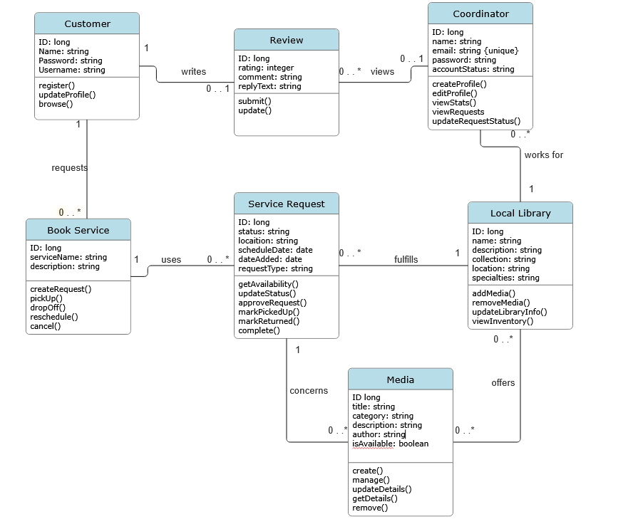

# LibraryPal Backend API Documentation

**Live Backend API:** [LibraryPal Backend](https://csc340-project-team7.onrender.com/)


## UML Class Diagram




## API Endpoints

The following table documents the endpoints implemented for the Customer, BookService, and Review features.

| HTTP Method | Endpoint | Description / Use Case | Success Status | Implemented By |
|---|---|---|---|---|
| POST | `/api/customers/register` | Register a new customer account | `201 Created` | Toni — Customer |
| GET | `/api/customers/{id}` | Retrieve a customer's profile | `200 OK` | Toni — Customer |
| PUT | `/api/customers/{id}` | Update a customer's profile | `200 OK` | Toni — Customer |
| GET | `/api/book-services` | List available book services | `200 OK` | Toni — BookService |
| GET | `/api/book-services/{id}` | Retrieve a book service by ID | `200 OK` | Toni — BookService |
| POST | `/api/book-services` | Create a book service | `201 Created` | Toni — BookService |
| PUT | `/api/book-services/{id}` | Update a book service | `200 OK` | Toni — BookService |
| DELETE | `/api/book-services/{id}?customerId={customerId}` | Delete a book service associated with the specified customer | Confirm in controller or API client | Toni — BookService |
| POST | `/api/reviews` | Submit a review for a customer | `201 Created` | Toni — Review |
| PUT | `/api/reviews/{reviewId}` | Update a review | `200 OK` | Toni — Review |


## Example Request Bodies

The following examples demonstrate the JSON request bodies for each POST and PUT endpoint.

### 1. Register a Customer

**Endpoint:** `POST /api/customers/register`

```json
{
  "name": "Example Customer",
  "username": "examplecustomer",
  "password": "ExamplePassword123!"
}
```

**Expected success status:** `201 Created`

**Use case:** Allows a new customer to register an account.

### 2. Update a Customer

**Endpoint:** `PUT /api/customers/{id}`

Example endpoint: `PUT /api/customers/1`

```json
{
  "name": "Updated Example Customer",
  "username": "examplecustomer"
}
```

**Expected success status:** `200 OK`

**Use case:** Updates an existing customer's profile.

### 3. Create a Book Service

**Endpoint:** `POST /api/book-services`

```json
{
  "serviceName": "Book Repair",
  "description": "Repair and restore damaged books",
  "customerId": 1
}
```

**Expected success status:** `201 Created`

**Use case:** Creates a new book service.

### 4. Update a Book Service

**Endpoint:** `PUT /api/book-services/{id}`

Example endpoint: `PUT /api/book-services/1`

```json
{
  "serviceName": "Updated Book Repair",
  "description": "Repair, restore, and preserve damaged books",
  "customerId": 1
}
```

**Expected success status:** `200 OK`

**Use case:** Updates an existing book service.

### 5. Submit a Review

**Endpoint:** `POST /api/reviews`

```json
{
  "customerId": 1,
  "rating": 5,
  "comment": "Testing the LibraryPal review API"
}
```

**Expected success status:** `201 Created`

**Use case:** Allows a customer to submit a review.

### 6. Update a Review

**Endpoint:** `PUT /api/reviews/{reviewId}`

Example endpoint: `PUT /api/reviews/2`

```json
{
  "customerId": 1,
  "rating": 4,
  "comment": "Updated review using EchoAPI"
}
```

**Expected success status:** `200 OK`

**Use case:** Updates an existing review.


The following examples demonstrate the JSON request bodies for the Coordinator, Local Library, and Media endpoints, along with the Service Request endpoints implemented for LibraryPal.
| HTTP Method | Endpoint | Description / Use Case | Success Status | Implemented By |
|---|---|---|---|---|
| GET | `/api/coordinators` | Retrieve all coordinators | 200 OK | Ashlyn - Coordinator |
| GET | `/api/coordinators/{id}` | Retrieve a coordinator by ID | 200 OK | Ashlyn - Coordinator |
| DELETE | `/api/coordinators/{id}` | Delete a coordinator | 204 No Content | Ashlyn - Coordinator |
| GET | `/api/coordinators/{id}/statistics` | View service-request statistics | 200 OK | Ashlyn - Coordinator |
| GET | `/api/libraries` | Retrieve all local libraries | 200 OK | Ashlyn - Local Library |
| GET | `/api/libraries/{id}` | Retrieve a library by ID | 200 OK | Ashlyn - Local Library |
| DELETE | `/api/libraries/{id}` | Delete a local library | 204 No Content | Ashlyn - Local Library |
| GET | `/api/media` | Retrieve all media items | 200 OK | Ashlyn - Media |
| GET | `/api/media/available` | Retrieve available media | 200 OK | Ashlyn - Media |
| GET | `/api/media/{id}` | Retrieve a media item by ID | 200 OK | Ashlyn - Media |
| GET | `/api/media/library/{libraryId}` | Retrieve media associated with a library | 200 OK | Ashlyn - Media |
| DELETE | `/api/media/{id}` | Delete a media item | 204 No Content | Ashlyn - Media |
| GET | `/api/service-requests` | Retrieve all service requests | 200 OK | Ashlyn - Service Request |
| GET | `/api/service-requests/{id}` | Retrieve a service request by ID | 204 No Content | Ashlyn - Service Request |
| DELETE | `/api/service-requests/{id}` | Delete a service request | 204 No Content | Ashlyn - Service Request |


### 1. Create a Coordinator

**Endpoint:** `POST /api/coordinators`

```json
{
  "name": "Jordan Smith",
  "email": "jordan.smith@example.com",
  "password": "ExamplePassword123!",
  "accountStatus": "ACTIVE"
}
```

**Expected success status:** `201 Created`

**Use case:** Creates a coordinator profile with a unique email address and an account status.

### 2. Update a Coordinator

**Endpoint:** `PUT /api/coordinators/{id}`

Example endpoint: `PUT /api/coordinators/1`

```json
{
  "name": "Jordan Smith Updated",
  "email": "jordan.smith@example.com",
  "password": "ExamplePassword123!",
  "accountStatus": "ACTIVE"
}
```

**Expected success status:** `200 OK`

**Use case:** Updates an existing coordinator's name, email, password, and account status. The password can be omitted or set to `null` to keep the existing password.

### 3. Create a Local Library

**Endpoint:** `POST /api/libraries`

```json
{
  "name": "Greensboro Central Library",
  "address": "456 Elm Street, Greensboro, NC"
}
```

**Expected success status:** `201 Created`

**Use case:** Creates a local library profile containing its name and address.

### 4. Update a Local Library

**Endpoint:** `PUT /api/libraries/{id}`

Example endpoint: `PUT /api/libraries/2`

```json
{
  "name": "Greensboro Central Library Updated",
  "address": "789 Main Street, Greensboro, NC"
}
```

**Expected success status:** `200 OK`

**Use case:** Updates an existing library's name and address.

### 5. Create Media

**Endpoint:** `POST /api/media`

```json
{
  "title": "Project Hail Mary",
  "location": "Greensboro Central Library",
  "available": true,
  "libraryId": 2
}
```

**Expected success status:** `201 Created`

**Use case:** Adds a media item to an existing local library. The `libraryId` must match the ID of a library already stored in the database.

### 6. Update Media

**Endpoint:** `PUT /api/media/{id}`

Example endpoint: `PUT /api/media/1`

```json
{
  "title": "Project Hail Mary - Updated Edition",
  "location": "Greensboro Central Library",
  "available": false,
  "libraryId": 2
}
```

**Expected success status:** `200 OK`

**Use case:** Updates a media item's title, location, availability, and associated local library.

### 7. Create a Service Request

**Endpoint:** `POST /api/service-requests`

```json
{
  "location": "Greensboro Central Library",
  "scheduleDate": "2026-11-15",
  "requestType": "PICKUP"
}
```

**Expected success status:** `201 Created`

**Use case:** Creates a pickup or drop-off service request. The initial status defaults to `PENDING`, and `dateAdded` is generated automatically.

### 8. Update a Service Request's Status

**Endpoint:** `PUT /api/service-requests/{id}/status`

Example endpoint: `PUT /api/service-requests/1/status`

```json
{
  "status": "APPROVED"
}
```

**Expected success status:** `200 OK`

**Use case:** Updates the status of an existing service request. Example statuses include `PENDING`, `APPROVED`, `COMPLETED`, and `CANCELLED`.

### 9. Reschedule a Service Request

**Endpoint:** `PUT /api/service-requests/{id}/reschedule`

Example endpoint: `PUT /api/service-requests/1/reschedule`

```json
{
  "scheduleDate": "2026-11-20"
}
```

**Expected success status:** `200 OK`

**Use case:** Changes the scheduled date of an existing pickup or drop-off request. Dates must use the `YYYY-MM-DD` format.

### 10. Cancel a Service Request

**Endpoint:** `PUT /api/service-requests/{id}/cancel`

Example endpoint: `PUT /api/service-requests/1/cancel`

No request body is required.

**Expected success status:** `200 OK`

**Use case:** Cancels an existing service request by changing its status to `CANCELLED`.

## Deployment

**Live Backend API:** [LibraryPal Backend](https://csc340-project-team7.onrender.com/)


### Cold-Start Note

If the backend is hosted on Render's free web service plan, it may spin down after 15 minutes without incoming traffic. The first request after inactivity can take approximately one minute while the service starts again. Subsequent requests should be faster once the service is running.
